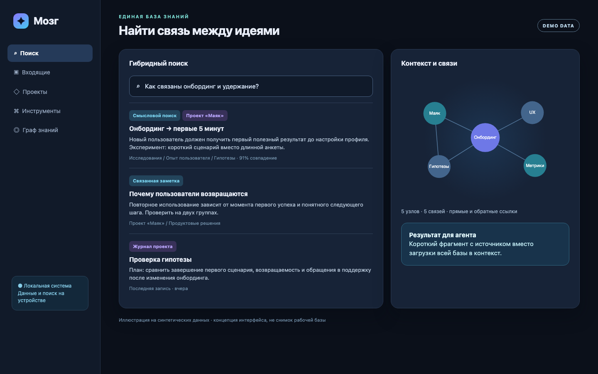
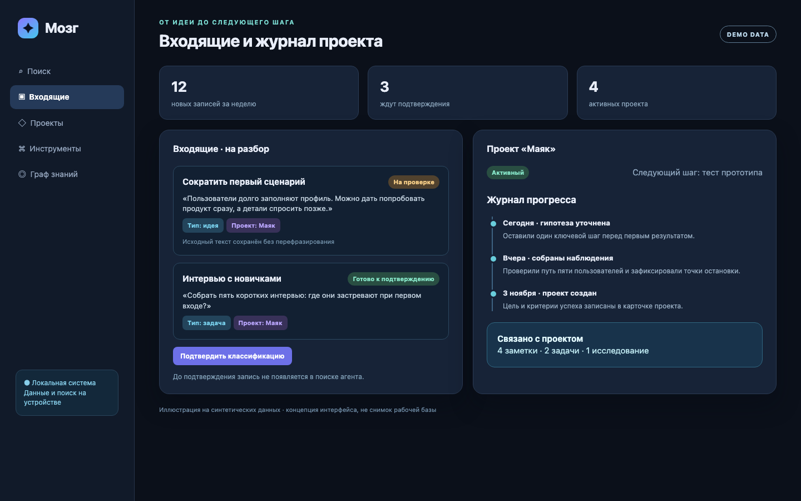
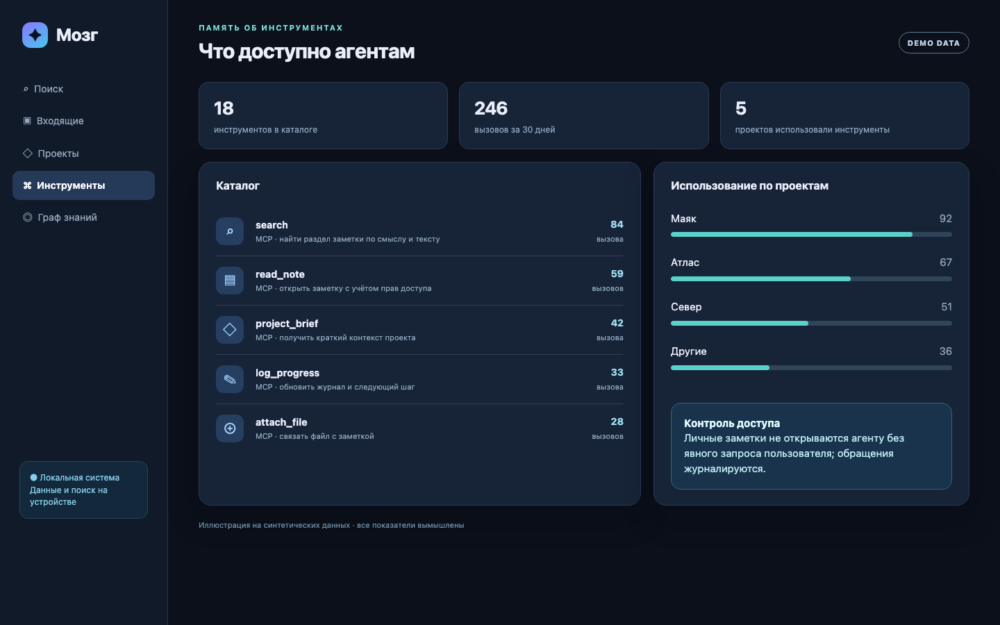
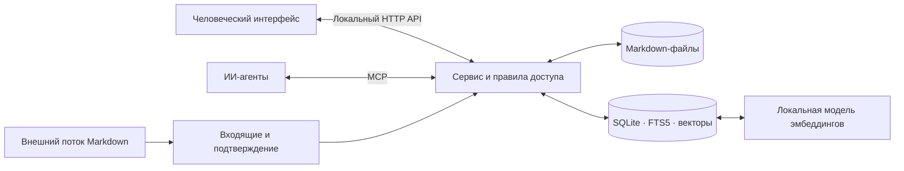

# Мозг — локальная память для людей и ИИ-агентов

  <strong>Заметки, проекты и инструменты в одной системе знаний</strong> 
  Поиск по смыслу · граф связей · входящие на разбор · журнал проектов · MCP для агентов

> Портфолио проекта. В этом репозитории находятся только описание и демонстрационные изображения. Исходный код системы, рабочая база знаний, конфигурация и ключи не публикуются.

## Как это выглядит

Все имена проектов, заметки и показатели на изображениях ниже вымышлены. Это **демонстрационная визуализация**, а не снимки личной базы или текущего интерфейса.

| Поиск и связи | Входящие и проекты | Инструменты агентов |
|:---:|:---:|:---:|
|  |  |  |

## Зачем я это сделал

Когда работа идёт одновременно в заметках, проектах и с несколькими ИИ-агентами, контекст быстро дробится: идея остаётся в чате, решение — в другом файле, а агент в новой сессии начинает заново. «Мозг» хранит знания локально и даёт человеку и агентам разные способы работать с одной базой.

## Возможности

| Возможность | Что происходит |
|---|---|
| Гибридный поиск | Сочетает смысловой поиск по разделам заметок и полнотекстовый поиск SQLite FTS5; выдаёт релевантный фрагмент и заголовок раздела. |
| Входящие | Принимает Markdown из внешнего потока, сохраняет оригинал и предложение по классификации; человек подтверждает заметку перед публикацией в базе знаний. |
| Граф знаний | Строит связи по явным ссылкам и `[[wikilinks]]`, показывает прямые и обратные связи. |
| Журнал проектов | Хранит этап, следующий шаг, последние записи о прогрессе и связанные заметки. |
| Инструменты агентов | Каталогизирует доступные навыки и MCP-инструменты, показывает их использование по проектам и агентам. |
| Вложения | Прикрепляет файлы к заметкам и отдаёт их по локальному API. |
| Контроль доступа | Разделяет видимость заметок для человека и агента; личные заметки открываются агенту только по явному запросу. |

## Как устроено

**Стек:** Python 3.12+, SQLite и FTS5, Markdown с YAML frontmatter, FastEmbed с мультиязычной моделью, NumPy, MCP SDK, локальный HTTP API на стандартной библиотеке Python, `uv`, `pytest`. Данные и модель эмбеддингов остаются на устройстве. HTTP и MCP слушают только `127.0.0.1` и требуют токен.

## Принципы реализации

- **Оригинал сохраняется:** ИИ предлагает тип, теги и проект, но не переписывает исходное сообщение при приёме.
- **Человек утверждает входящие:** неподтверждённые записи не появляются в поиске агента.
- **Сбой не теряет заметку:** публикация Markdown атомарна; после прерывания сервис восстанавливает незавершённую запись.
- **Экономия контекста:** поиск отдаёт короткие подходящие разделы, а не целые документы.

## Что показывают изображения

1. **Поиск:** запрос на естественном языке находит раздел заметки; рядом видны связанные записи.
2. **Входящие и проекты:** исходный текст проходит предложенную классификацию и попадает в проект после подтверждения; журнал фиксирует следующий шаг.
3. **Инструменты:** агент видит доступные навыки и частоту использования без доступа к содержимому личных заметок.

## Статус и границы демонстрации

Ядро хранения, поиск, MCP, HTTP API, входящие, граф, журнал проектов, вложения и учёт инструментов реализованы в личной установке. Демонстрационные изображения показывают концепцию интерфейса на синтетических данных; они не подтверждают, что именно такой экран уже доступен в продукте. Отдельный Telegram-бот и интерфейс хаба — внешние части экосистемы.

Репозиторий предназначен для знакомства с архитектурой и результатом работы. Он не является дистрибутивом и не содержит кода, из которого можно собрать систему.
