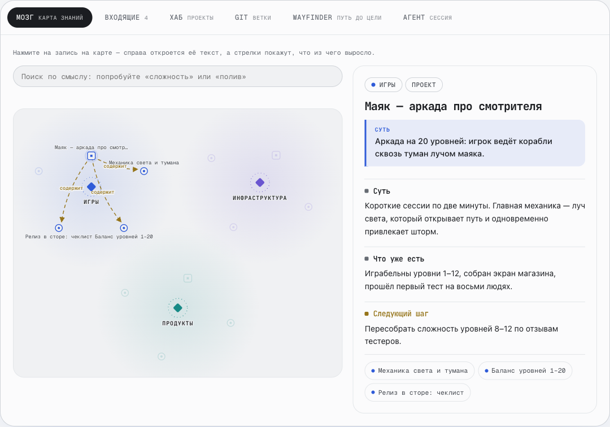
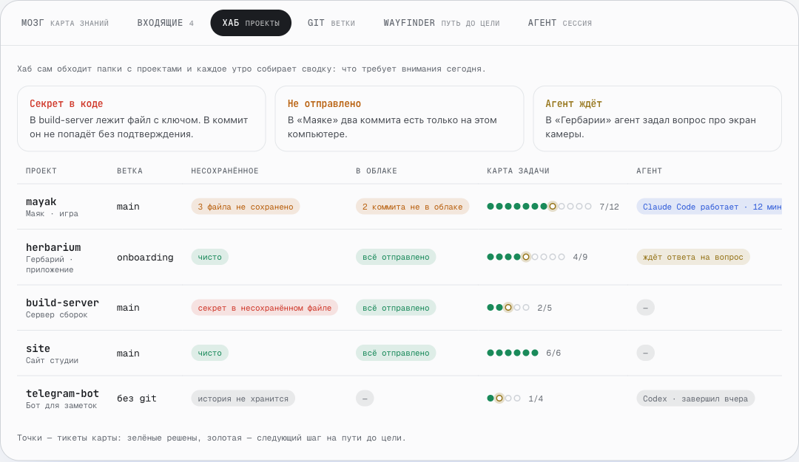
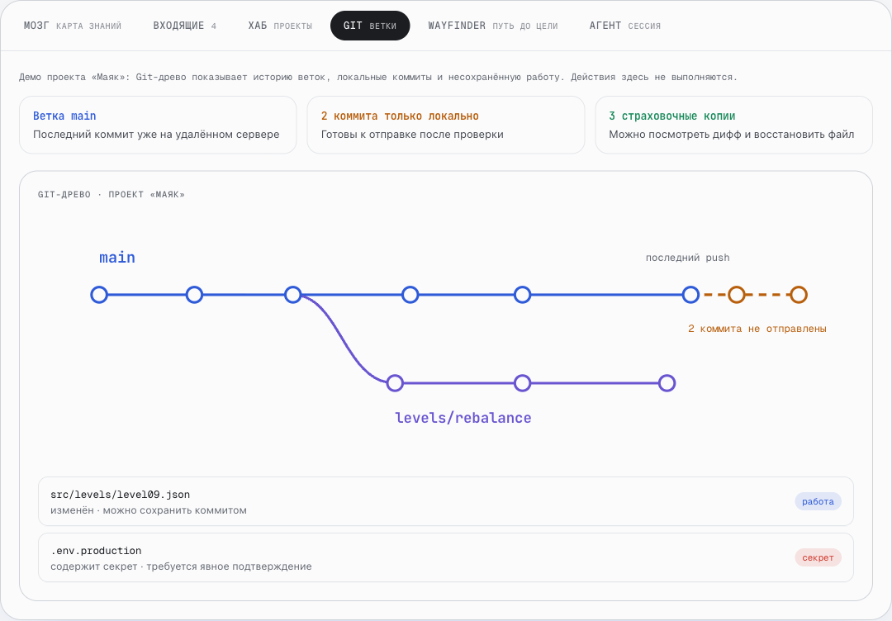
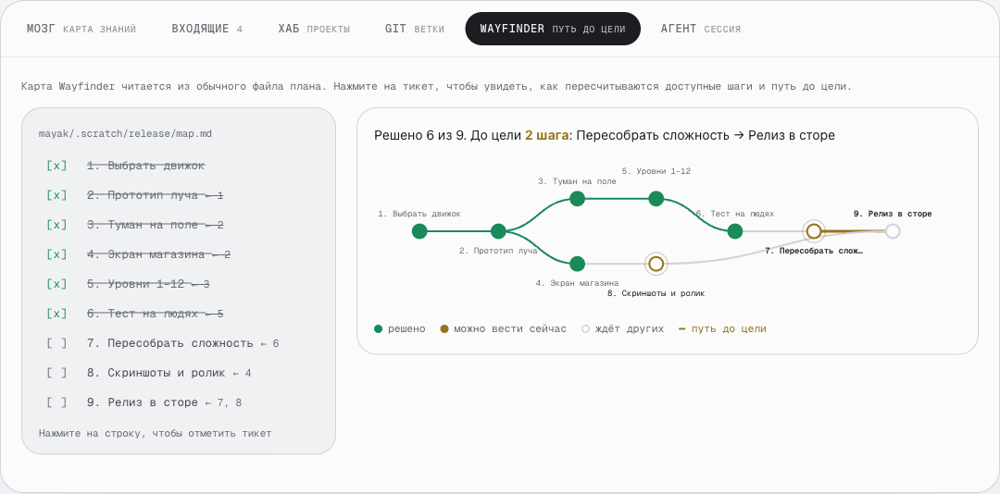
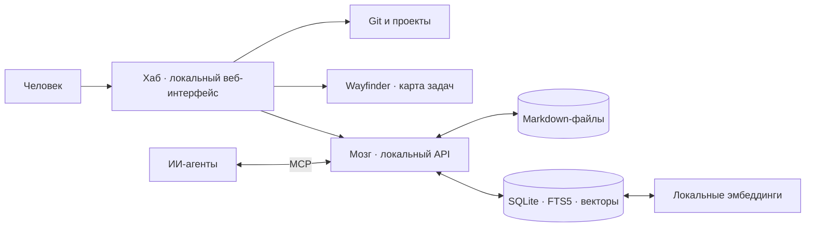

# Хаб и Мозг — рабочее место студии

**Проекты, память и работа ИИ-агентов в одном локальном интерфейсе.** Хаб показывает состояние проектов и Git; Мозг хранит знания и отдаёт нужный контекст человеку и агентам.

### [Открыть интерактивную демонстрацию →](https://kokodede32433-cmd.github.io/second-brain-showcase/)

На странице можно переключать разделы, открывать записи Мозга, проходить Git-сценарий и менять статусы задач Wayfinder. Интерфейс использует стиль и анимацию рабочего Хаба; названия проектов, содержимое и показатели вымышлены. Это самостоятельная демонстрация сценариев, а не подключение к личной установке.

| Мозг: карта знаний | Хаб: проекты и сигналы |
|:---:|:---:|
|  |  |

| Git: ветки и несохранённая работа | Wayfinder: путь до цели |
|:---:|:---:|
|  |  |

## Что умеет система

| Часть | Возможности |
|---|---|
| **Мозг** | Локальные Markdown-записи; гибридный поиск по смыслу и словам; граф явных ссылок и `[[wikilinks]]`; входящие с предложенной классификацией и подтверждением человеком; журнал проектов и вложения. |
| **Агенты** | MCP-инструменты для поиска и работы с контекстом; каталог навыков и инструментов; разграничение доступа к личным записям. |
| **Хаб** | Единый экран проектов и сигналов внимания; состояние Git, ветки, локальные и удалённые коммиты, изменённые файлы; автоматические снимки и восстановление; работа с агентами. |
| **Wayfinder** | Карта задач из Markdown-плана: зависимости, выполненные и доступные шаги, маршрут до цели. При изменении статуса карта и следующий шаг пересчитываются. |

## Сценарии в демо

1. **Мозг:** нажмите на запись в карте знаний, чтобы увидеть её содержание и связи.
2. **Хаб и Git:** откройте сигналы проекта, затем проследите ветвление, локальные коммиты и файлы, которые требуют внимания.
3. **Wayfinder:** отметьте задачу в плане и посмотрите, как изменится маршрут до релиза.
4. **Агент:** изучите, какой контекст получает новая сессия и какие действия доступны через инструменты.

## Устройство

**Стек:** Python 3.12+, SQLite FTS5, Markdown с YAML frontmatter, FastEmbed, NumPy, MCP SDK; локальный HTTP API; интерфейс Хаба на HTML, CSS и JavaScript. Данные Мозга и индекс хранятся на устройстве. Внешние интеграции и модели используются только для соответствующих сценариев.

## Границы публикации

Репозиторий содержит описание, снимки и автономную интерактивную демонстрацию на синтетических данных. Исходный код рабочих Хаба и Мозга, личная база знаний, настройки и ключи здесь не публикуются. `index.html` можно открыть и изучить как код демонстрации; это не исходный код самой системы.
